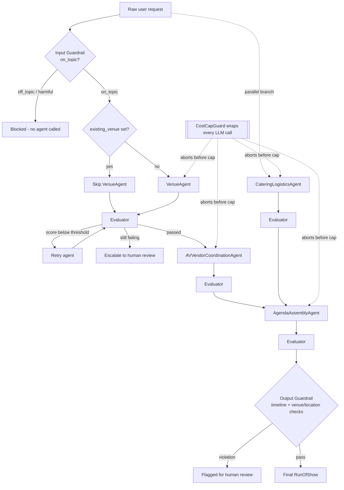

# Agent Flow Diagram

Full flow of one event-planning request through the guarded, orchestrated, evaluated
multi-agent system (`Task3.ipynb` orchestrator + `Task4.ipynb` evaluator + `Task5.ipynb`
guardrails combined).

## ASCII

```
Raw user request
      │
      ▼
┌───────────────────────────┐
│   Input Guardrail          │  off_topic / harmful -> BLOCKED, no agent called
│   (on_topic? classifier)   │
└─────────────┬───────────────┘
              │ on_topic
              ▼
      ┌───────────────┐
      │ existing_venue │
      │   set?         │
      └───┬───────┬───┘
     yes  │        │ no
          ▼        ▼
     ┌─────────┐ ┌────────────┐          ┌───────────────────────────┐
     │  Skip    │ │ VenueAgent │          │  CateringLogisticsAgent   │ (independent -
     │ VenueAgent│ │(cost-capped)│         │      (cost-capped)        │  runs in parallel
     └────┬────┘ └─────┬──────┘          └─────────────┬─────────────┘  with venue/AV)
          │            │  ──────► Evaluator (score, retry once, else escalate) ─────┐
          └─────┬──────┘                                                            │
                ▼                                                                   │
      ┌───────────────────────────┐                                                 │
      │ AVVendorCoordinationAgent  │ ──────► Evaluator (score, retry once, else     │
      │       (cost-capped)        │          escalate)                             │
      └─────────────┬───────────────┘                                               │
                     │                                                              │
                     └───────────────────────────┬──────────────────────────────────┘
                                                  ▼
                                      ┌───────────────────────────┐
                                      │   AgendaAssemblyAgent      │ (join: venue + catering + av)
                                      │       (cost-capped)        │
                                      └─────────────┬───────────────┘
                                                    │ ──────► Evaluator (score, retry once,
                                                    │          else escalate)
                                                    ▼
                                      ┌───────────────────────────┐
                                      │    Output Guardrail        │
                                      │ (timeline feasibility +    │
                                      │  venue/location checks)    │
                                      └─────┬───────────────┬───────┘
                                       fail  │               │ pass
                                            ▼                ▼
                                  Flagged for human    Final RunOfShow
                                      review              returned

Cost-Cap Guard wraps every single LLM call above (venue/catering/AV/agenda/evaluator/
classifier) and aborts the whole pipeline BEFORE any call that would push estimated spend
over the configured cap, returning a graceful user-facing message instead.
```

## Mermaid


